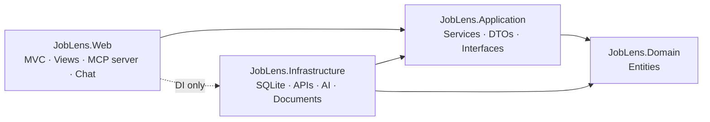
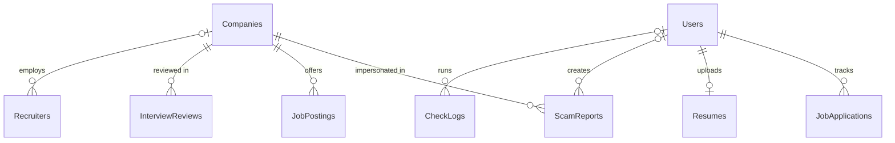

# 🛡️ JobLens — Job & Internship Scam Shield

> **We verify the recruiter, not just the job.**

JobLens helps college students and university career centers spot fake recruiters and scam job offers **before** a student sends money or personal data. It combines official company data, community scam reports and live public registries into one clear risk verdict, and adds an AI assistant that answers **only from JobLens data** through MCP tools.

| | |
|---|---|
| **Live app** | https://joblens-ism6225-bqfsg5hsenfjg0cu.westus3-01.azurewebsites.net |
| **Full documentation** | [docs/DOCUMENTATION.md](docs/DOCUMENTATION.md) — architecture, ERD, feature flows, MCP tools, security, Q&A |
| **Course** | ISM 6225 · Application Development for Analytics · University of South Florida |

---

## The problem

- **Fake recruiters** copy real company names and write from look-alike domains such as `hr@amaz0n-careers.net`.
- **Scam offers** ask students to deposit checks, buy equipment, pay "training" or "visa" fees, or share SSN and bank details. International students are frequent targets.
- **Warnings are scattered** across group chats and emails, and nobody connects the reports.

## What JobLens does

| Area | Feature |
|---|---|
| **Check** | **Check a Recruiter** — 0–100 risk score from official domains, look-alike detection, approved community reports, live domain age (RDAP) and SEC EDGAR records · **Offer Analyzer** — paste or upload a PDF/DOCX offer; personal data is redacted, then AI (or a rule checklist) flags scam patterns |
| **Find** | **Jobs** — live federal openings from **USAJOBS** (Students & interns by default, "Official .gov" badge) and JobLens-curated postings with AI **Smart Search** |
| **Community** | Scam Reports, Companies, Recruiters and Interview experiences (full CRUD); moderators approve or reject reports |
| **Insights** | **Scam Insights Dashboard** — Chart.js KPIs and trends that update with every CRUD change |
| **Ask** | **Ask JobLens** — chatbot that answers only by calling 10 read-only **MCP tools**; falls back to a rule-based Demo mode if AI is unavailable |
| **My JobLens** | **My Applications** (tracker with recruiter risk badges, follow-ups, CSV export) · **Email drafts** (switches to "Verify recruiter" when the recruiter looks risky) · **My Resume** (flags SSN, date of birth and home address before you share it) |

---

## Tech stack

**C# .NET 10 · ASP.NET Core MVC · SQLite with ADO.NET (no Entity Framework) · Model Context Protocol (`ModelContextProtocol.AspNetCore` 2.2.0) · Azure OpenAI gpt-4.1-mini (`Microsoft.Extensions.AI`) · Chart.js · Mermaid · xUnit · Azure App Service (Linux)**

## Architecture

Clean Architecture with four projects. Dependencies point inward, and **all SQL lives in `Infrastructure/Persistence`**.



- **Writes** go only through MVC forms → Application services (validation, ownership rules) → repositories (parameterized SQL).
- **The chatbot** is an MCP client of the app's own `/mcp` server; the AI can only **read** through narrow tools and never runs SQL.

```
joblens-chat/
├── JobLens.slnx · global.json · .cursorrules
├── src/
│   ├── JobLens.Domain/          entities + constants
│   ├── JobLens.Application/     services, DTOs, interfaces
│   ├── JobLens.Infrastructure/  SQLite repositories, seed, RDAP/EDGAR/USAJOBS clients, AI, PDF/DOCX
│   └── JobLens.Web/             controllers, views, Mcp/ tools, Chat/, Program.cs
├── tests/JobLens.Tests/         xUnit tests
├── scripts/                     db-counts, azure-appsettings.ps1
└── docs/                        documentation, testing, evidence, demo files
```

---

## Data model

9 SQLite tables, created and seeded automatically on first run.



Seeded data: **20** companies · **120** scam reports (85 approved / 23 pending / 12 rejected) · **130** recruiters · **70** job postings · **50** interview experiences · **100** check logs · **5** users · **12** demo applications. Column-level ERD: [DOCUMENTATION.md §5](docs/DOCUMENTATION.md#5-database--data-models).

## CRUD overview

| Entity | Who can create / edit / delete | Reflected in |
|---|---|---|
| Scam Reports | Any signed-in user (own reports while Pending); moderators approve, reject, edit, delete | Dashboard, Home alerts and stats, Check Recruiter score, Company details, MCP tools |
| Companies | Moderators | Official-domain checks, Jobs, Dashboard, `get_company_profile` |
| Recruiters | Moderators | Check Recruiter, Company details |
| Job Postings | Moderators | Jobs → JobLens postings, Dashboard, `search_jobs` |
| Interview experiences | Signed-in users (own) and moderators | Company details (suspicious count), Dashboard rating |
| My Applications · My Resume | The owner only | Home "Your week", Dashboard "My pipeline", Email drafts, Resume match |

---

## APIs and endpoints

### External APIs (fetch-only, never stored)

| API | Used for | Caching |
|---|---|---|
| [RDAP](https://about.rdap.org/) (Verisign, PIR, rdap.org) | Domain registration date / age in Check Recruiter and chat | 6 hours |
| [SEC EDGAR](https://www.sec.gov/files/company_tickers.json) | Public company record (ticker, CIK) | 24 hours |
| [USAJOBS Search API](https://developer.usajobs.gov/) | Live federal job openings | 30 minutes |
| Azure OpenAI (gpt-4.1-mini) | Chat, offer analysis, email drafts, Smart Search | — (Demo / rule fallback) |

### MCP server — `POST /mcp` (header `X-Api-Key`)

| Tool | What it returns |
|---|---|
| `summarize_scams` | Totals by status, type and channel; money requested |
| `top_impersonated_companies` | Companies ranked by approved reports |
| `get_domain_report` | Approved reports for one domain |
| `search_scam_reports` | Filtered approved reports (type, company, channel, dates) |
| `check_recruiter_email` | Risk score, verdict and reasons |
| `get_company_profile` | Company details joined with postings, reviews and reports |
| `search_jobs` | JobLens postings by keyword, company, state, remote, pay |
| `analyze_offer` | Red flags in an offer text (redacted first) |
| `lookup_domain_registration` | Live RDAP registration data |
| `search_live_jobs` | Live USAJOBS openings with trust signals |

### App endpoints

| Endpoint | Purpose |
|---|---|
| `/CheckRecruiter`, `/OfferAnalyzer`, `/Jobs`, `/Chat` | Core student tools |
| `/ScamReports`, `/Companies`, `/Recruiters`, `/InterviewReviews`, `/JobPostings` | CRUD pages |
| `/Dashboard` · `/Dashboard/Data?range=` | Dashboard page and its JSON API |
| `/Applications` (+ `/Export`), `/EmailDrafts`, `/Resume` | Signed-in student features |
| `/healthz` | Health check (`ok` when SQLite responds) |

---

## Run it locally

**Prerequisites:** .NET 10 SDK (pinned in `global.json`).

```powershell
git clone https://github.com/SathvikReddySirigiri/joblens-chat.git
cd joblens-chat
dotnet run --project src/JobLens.Web --launch-profile http
```

Open http://localhost:5080. The SQLite database is created and seeded in `src/JobLens.Web/App_Data/` on first run.

**Demo accounts (Development defaults only):**

| Email | Role | Password |
|---|---|---|
| `moderator@joblens.demo` | Moderator | `Moderator#2026` |
| `student1@joblens.demo` … `student4@joblens.demo` | Student | `Student#2026` |

On Azure these are replaced by secret passwords from App Settings; production refuses to start without them.

**Optional keys (user-secrets — never in source control):**

```powershell
dotnet user-secrets set "Ai:Provider" "AzureOpenAI" --project src/JobLens.Web
dotnet user-secrets set "Ai:Endpoint" "https://<resource>.openai.azure.com/" --project src/JobLens.Web
dotnet user-secrets set "Ai:Model" "gpt-4.1-mini-1" --project src/JobLens.Web
dotnet user-secrets set "Ai:ApiKey" "<key>" --project src/JobLens.Web
dotnet user-secrets set "Mcp:AccessKey" "<local-key>" --project src/JobLens.Web
dotnet user-secrets set "Edgar:UserAgent" "JobLens ISM6225 <your-email>" --project src/JobLens.Web
dotnet user-secrets set "Jobs:UsaJobs:ApiKey" "<usajobs-key>" --project src/JobLens.Web
dotnet user-secrets set "Jobs:UsaJobs:UserAgent" "<usajobs-registered-email>" --project src/JobLens.Web
```

Without an AI key the app runs in **Demo mode** (rule-based), so every page still works.

**Connect an MCP client:** MCP Inspector (`npx @modelcontextprotocol/inspector`, Streamable HTTP, `http://localhost:5080/mcp`, header `X-Api-Key`) or Cursor — copy `.cursor/mcp.example.json` to `.cursor/mcp.json` (git-ignored) and add your key.

## Test it

```powershell
dotnet test
```

95 xUnit tests cover seed counts and known answers, validation, ownership and roles, approved-only MCP results, rate limiting, the MCP access key, PII redaction, RDAP and USAJOBS parsing, email-draft safety rules, resume privacy checks and CSV export. Acceptance tests (A1–A10), chatbot questions (T01–T12), security (S01–S10) and feature checks (F01–F12) are in [docs/testing/test-matrix.md](docs/testing/test-matrix.md), with screenshots in [docs/evidence/](docs/evidence/).

## Deploy to Azure

Azure App Service (Linux, .NET 10), resource group `rg-joblens`. SQLite lives on the persistent `/home` share, so data survives restarts.

```powershell
az login
# 1. App settings from local user-secrets + newly generated production secrets (prints them once)
./scripts/azure-appsettings.ps1 -AppName joblens-ism6225
# 2. Build and deploy
dotnet publish src/JobLens.Web/JobLens.Web.csproj -c Release -o publish
cd publish; tar.exe -a -c -f ..\joblens.zip *; cd ..
az webapp deploy -g rg-joblens -n joblens-ism6225 --src-path joblens.zip --type zip
```

Startup command `dotnet JobLens.Web.dll` · health check `/healthz` · HTTPS only. App setting names are listed in [DOCUMENTATION.md §12](docs/DOCUMENTATION.md#12-deployment-azure).

---

## Security at a glance

- Parameterized SQL everywhere; SQLite `CHECK`, `UNIQUE` and foreign-key constraints
- AI is read-only through MCP tools; no SQL tool and no write tools
- `X-Api-Key` on `/mcp` (fails closed in production)
- Hashed passwords, secure HttpOnly cookies, antiforgery tokens, role and owner checks
- PII redaction before any text reaches the AI; resume originals are never stored
- Rate limits: login 5/min, expensive endpoints 10/min per IP
- Secrets only in user-secrets or Azure App Settings

## Challenges and how we solved them

| Challenge | Solution |
|---|---|
| GitHub Models was retired and the first Azure model had no quota | Moved to Azure OpenAI **gpt-4.1-mini** (Global Standard) and added a rule-based **Demo mode** so the app never depends on AI being up |
| The chatbot could overstate facts (e.g. calling an old domain "legitimate") | Grounding rules in the system prompt, approved-only tool data, and known-answer tests (T01–T12) |
| RDAP lookups timed out or returned unusual JSON | Registry-first lookups (Verisign, PIR) with per-attempt timeouts, an `rdap.org` fallback, 6-hour caching and a tolerant parser |
| The first live-jobs API (The Muse) was blocked on our network | Put live jobs behind `ILiveJobsProvider` and switched to the official **USAJOBS** API |
| Azure free-trial App Service quota and throttling | Found the one region with quota (West US 3); deployed with the Azure CLI zip deploy after the portal's GitHub setup failed |
| Keeping students' data private | Owner-only queries (others get Not Found), PII redaction, redacted-only resume storage |

---

## Documentation

- [Complete documentation](docs/DOCUMENTATION.md) — architecture diagrams, ERD, feature walkthroughs, MCP tools, security, startup, professor Q&A
- [Test matrix](docs/testing/test-matrix.md) · [Known answers](docs/testing/known-answers.md) · [Evidence](docs/evidence/)
- [Proposal](docs/proposal.md) · [AI use record](docs/ai-use-record.md) · [Team record](docs/team-record.md)

## Credits

Chart.js 4.4.6 (MIT) and Mermaid are served locally from `wwwroot/lib`. Live job listings come from [USAJOBS](https://www.usajobs.gov) and are not stored by JobLens. Scam data is **sample data for education** and is not a legal finding about any company.
